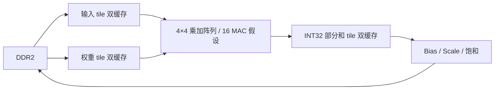

# YOLO-FastestV2 + 开源加速器可行性验证（2026-10-12）

## 结论和边界

**软件复现 PASS；原版权重在本次三类检测目标上效果 FAIL；原版 16 MAC / 100 MHz / 352 输入的 30 fps 硬件路线 NO-GO。** 本报告是隔离的软件和 Icarus RTL 算术预研。没有 INT8 全网量化、网络硬件等价模型、安路 DSP 映射、DDR2 实测、TangDynasty 综合或 PH1P35 上板证据。G1/G2 与 `VISUAL_APPROVED` 阶段门仍未通过。微型网络训练研究可继续，但不能凭本报告进入视频 RTL。

## 来源、版本与许可

| 项目 | 固定版本 | 可使用范围 |
|---|---|---|
| [dog-qiuqiu/Yolo-FastestV2](https://github.com/dog-qiuqiu/Yolo-FastestV2) | `ac2a5e3060bff76dd1e45f9b921dd77bfbeb194d` | 仓库未见 LICENSE/COPYING；本次仅本地运行官方代码和预训练权重，不将其代码纳入交付 RTL。版权许可待权利人澄清。 |
| 官方 COCO checkpoint | `modelzoo/coco2017-0.241078ap-model.pth`，SHA-256 `bdd956aa079bf1cdd3e0090a295ac26d73c40aef7b61b6405981b1afcbea985c`，Git blob `cd363ca1fe822bb1209e126193ba10a2b7d9d467` | 原 80 类权重，无三类重训。 |
| [adamgallas/fpga_accelerator_yolov3tiny](https://github.com/adamgallas/fpga_accelerator_yolov3tiny) | `6ba312bd220e67a987d3417bacd030db30b15770` | Apache-2.0；只在隔离目录分析和仿真。源文件在 `vivado_prj/source/`；Xilinx `use_dsp` 属性不证明安路映射。 |
| COCO val2017 | `instances_val2017.json` SHA-256 `e8c7f7908f1d7278341fae127d0da654f102f11bd7b21d8aeefa635b8c810b6f` | 原图保持各自许可；仅作公开数据研究。 |

克隆仓库在 `upstream/`，不纳入项目源代码。`run_windows.bat --bootstrap` 可重新获取固定版本、验证权重和输入文件哈希，再运行全套实验；已有快照时直接运行 `run_windows.bat`。Python 环境为 Windows Python 3.13.7、PyTorch 2.14.0+cpu、torchvision 0.29.1+cpu、OpenCV 4.13.0、NumPy 2.4.3；实际入口默认 `work/y1_yolo/.venv/Scripts/python.exe`。需有 Git、Icarus `.tools/iverilog/bin` 及 Python 依赖；脚本在缺失时会报错，不把失败当通过。

## 官方软件复现与效果

官方 `test.py` 对 `120777`、`563882`、`119233` 三张指定图均成功生成输出，日志及图片在 `results/official/`；图像 ID、文件名、尺寸、SHA-256 和目标标注见 `results/official/source_metadata.json`。预处理按官方 BGR、整图非等比 resize 到 352×352、NCHW、float/255；后处理保持双尺度、每尺度 3 anchor、80 类 softmax、目标置信度相乘、0.3 阈值、0.4 类别偏移 NMS、原图坐标反缩放。`check_decode.py` 用独立 NumPy 实现检查三图：每图 NMS 检测数一致（4、4、2），解码最大绝对差 ≤0.000123，NMS 输出最大差 ≤0.000031；`results/decode_check/comparison.json` 记录逐框类别、置信度、原图坐标和参数，`*_all_80_class_candidates.npz` 保留 80 类原始解码候选。这验证软件包装没有明显类别/坐标错误，不等于模型检测正确。

新测试在推理前冻结 `data/frozen_eval_manifest.json` 和 60 张图片 SHA-256（`data/image_sha256.json`），排除已有 Y1/Y2 manifest 的图像 ID 及三张官方示例。45 张选择含目标图，15 张没有这三类标注；其他 COCO 类别可以出现。只以 COCO 原标注评价 IoU≥0.5，排除一个 `iscrowd` 瓶子标注。固定阈值 0.3，NMS 0.4；表中 AP50 是从 **0.3 截断后的候选**算出的样本内 PR 面积，不是从低阈值完整排序得到的标准 COCO AP，也不是工位独立测试。没有按场景/摄影批次隔离，公开权重的原始训练来源是否与这些 val 图交叉未核查。

| 352 输入 | GT | TP | FP | FN | Precision | Recall | 抽样 AP50 |
|---|---:|---:|---:|---:|---:|---:|---:|
| bottle | 52 | 0 | 3 | 52 | 0 | 0 | 0 |
| cup | 60 | 3 | 8 | 57 | 0.273 | 0.050 | 0.030 |
| cell phone | 22 | 5 | 1 | 17 | 0.833 | 0.227 | 0.227 |

三类抽样 AP50 宏平均 0.0856。15 张没有三类标注的图片中，三类误报 0 张/0 框；小样本空场结果不能代替工位误报率。示例：杯子正确匹配图 `results/frozen_eval_352/000000120853.jpg`、手机正确匹配图 `results/frozen_eval_352/000000036660.jpg`；把瓶子误判为杯子的失败图 `results/frozen_eval_352/000000050811.jpg`，瓶子漏检图 `results/frozen_eval_352/000000064868.jpg`（原图 `data/images/000000064868.jpg`）。逐框结果与全部 80 类输出在 `results/frozen_eval_352/detections.json`。保留了完整 80 类输出，筛选三类展示；没有声称三类重训。单线程 CPU、预热 3 次后 60 图顺序测试，最近一次完整复现 forward 中位 8.42 ms、后处理中位 1.37 ms、总耗时中位 9.84 ms、P95 10.70 ms；重复运行总耗时中位曾在 9.10–11.73 ms 之间，说明受本机负载影响。计时包含软件解码/NMS，不包括文件读取、显示、视频链路；不是 FPGA 延迟。

为评估阈值截断影响，另在相同冻结集上以 0.001 阈值运行一次，不据此重新选择默认阈值。bottle/cup/phone 的 PR 面积约 0.0143/0.1422/0.3501，宏平均约 0.1689；最终 TP/FP 分别为 7/410、23/614、11/188。该数值仍受官方 max 300 detections/NMS 和本脚本简化 COCO crowd 规则影响，只称作**低阈值抽样 AP50**，不是 COCO 官方 AP。原版模型即使降低阈值也带来大量误报，不能借调阈值宣称应用效果达标；原始 JSON 在 `results/frozen_eval_352_conf0001/summary.json`。

352 权重直接改输入并保持原 anchor 的探索性对比：160 输入 TP 为 bottle/cup/phone 0/3/0，128 为 0/1/0，96 为 0/1/0。固定原 anchor 与训练尺度并不保证在新尺寸上有效；若选择较低分辨率，需重新设计 anchor/训练或验证等效尺度。各尺寸完整 JSON 在 `results/frozen_eval_*/summary.json`。

## 实际网络和硬件预算

PyTorch 实际前向 hook 记录 199 次叶模块调用、79 次 Conv2d 调用，六个输出为 22×22 的 12/3/80 通道与 11×11 的 12/3/80 通道。唯一参数 243,095；卷积总计 106,382,232 MAC（按乘加两次运算约 0.213 GOP，与官方 0.212 GFLOPs 量级相符）。逐层形状、分组、卷积核、参数、MAC、INT8 假设下的输出大小见 `results/profile/network_layers.csv` 和 `results/budget/layer_budget.csv`。这不是导出的定点计算图；BN 折叠、shuffle/concat、量化、后处理与张量存活期尚需设计。

最大**单张**卷积输出为第一层 24×176×176 = 743,424 B INT8，不能误写成整个网络峰值。固定 352 输入的 `torch.export` 图有 728 个节点；把视图/别名也当成独立 INT8 张量时，保守活跃张量峰值为 1,486,848 B，发生在第一层 BatchNorm 前后；这是软件图的粗上界，不是实际 BRAM 需求。记录见 `results/profile/graph_liveness.json`。INT8 权重按每参数 1 B 的粗下界为 243,095 B，约 95 个 ERAM20K，不含 scale、zero point、bias 或对齐。当前 `work/td_cartoon/td_project/camera_to_dsi_display_Runs/phy_1/camera_to_dsi_display_phy.area` 的 *另一工程变体* 报告：14,848/21,216 Slice、39/108 ERAM20K、8/40 DSP，即名义未占用 6,368 Slice、69 ERAM、32 DSP。此报告不是当前检测器可直接使用资源的证明。单权重下界和单张特征均超过该余量；须 DDR2/片上分块和完整活跃期方案。

在 100 MHz、16 个**持续每拍有效** MAC、零搬运/控制/NMS 开销的理想下界，352 一帧卷积需 6,648,890 拍，即 66.49 ms、最多 15.04 fps。32 MAC 理想下界 33.24 ms，已几乎用满 30 fps 的 33.33 ms 帧周期。30 fps 至少需平均 31.91 有效 MAC/拍，实际还要负担访存、depthwise 利用率、padding、量化、分类 softmax、NMS 和与视频并发争用。以 `Tn=Tm=4, Tr=Tc=26` 的 3×3 假设，仅一个输入 tile 双缓冲 6,272 B、INT32 部分和双缓冲 21,632 B，总 27,904 B ≈11 个 ERAM20K；不含行缓存、权重、多个活跃特征和地址控制。常规卷积按满 tile 扣除边缘效率的独立上界式成本为 12,204,504 拍，**未包含 27 次 depthwise**，不能拿来当完整延迟。若每次卷积输入/输出都落 DDR，按 INT8 张量合计约 6.02 MB/帧、30 fps 约 180.5 MB/s，这只是指定访存情形；真实 DDR2 时钟、突发效率、仲裁与视频流开销未知，不能据此断言带宽够或不够。

DSP 映射分情形：若每个剩余 DSP 仅承载 1 个 8×8 MAC，16 MAC 占 16 DSP；若能稳定双打包且支持所需累加，16 MAC 可占约 8 DSP；若用 16 个 LUT 乘法器，则 DSP 可为 0，但 Slice、布线、Fmax 消耗未知。实际数量须以 TD 最小算子综合报告证明。原 Xilinx 打包乘法经过 372 个边界/随机向量仿真，算术结果正确；`use_dsp` 属性不迁移为安路双乘映射证明。完整预算见 `results/budget/summary.json`。

下图仅表示待验证的分块数据流：

3×3 stride=1、halo=1 的**示例 tile**：输入双缓存 `2×28×28×4=6,272 B`；只保存量化后的 INT8 输出双缓存 `2×26×26×4=5,408 B`；权重双缓存 `2×3×3×4×4=288 B`，bias/scale 另计约几十字节。若输出必须跨输入通道 tile 累积，INT32 部分和双缓存 `2×26×26×4×4=21,632 B`，与输入/权重至少合计 28,192 B、按纯容量至少 12 块 ERAM20K。当前 `summary.json` 的 11 块数字仅含输入和部分和、未含权重；端口、banking、对齐和碎片还会增加实际块数。1×1、stride=2、depthwise 的 halo 和 bank 需求必须重新计算。第一层整张特征以及 Neck 的双尺度分支需要独立存活或 DDR spill；不能用 tile 装得下推断整网装得下。

16 MAC/100 MHz 的敏感性：100% 利用率 66.49 ms（15.0 fps）；75% 约 88.65 ms（11.3 fps）；50% 约 132.98 ms（7.5 fps）。这些只按卷积 MAC 除有效吞吐，访存/调度/后处理可能与计算部分重叠，不能机械相加，也不能当板级 FPS。

## 开源 RTL 审计与仿真

`check_rtl.py` 使用 Icarus 运行原文件，先以保持多拍刺激检查稳定算术值：`cal_mult_int8_x2`+`_dsp` 372/372 对照 `a*c`、`b*c`；`cal_scale_shift`+`cal_sat_int16_int8` 352/352 对照原位切片舍入和有符号饱和。另以 120 个连续输入、5 个排空周期检查逐拍事务：乘法器 4 个采样边沿、19 位候选加法树 2 个、scale+sat 2 个边沿，480 个对照值无差异。原算子没有 valid/ready 或 reset 端口；随机停顿与复位语义需由上层封装定义。该舍入规则对负数是否符合未来网络量化方案仍未知。

原版 `cal_addtree_int16_x9` 305 向量中 4 个与**精确整数求和**不一致。9×16,384 应为 147,456，原版 18 位输出 -114,688；9×(-16,384) 应为 -147,456，原版输出 114,688。原文件未改。隔离 `rtl_candidate/cal_addtree_int16_x9_wide.v` 用 19 位求和，同组 305/305 通过；9 个乘法器 + 19 位树 + bias + scale + sat 的最小链 186/186 整数输出通过，固定随机种子和期望向量在 `results/rtl/chain_vectors_expected.json`。候选输出接口变化需要下游重新审计，不能直接替换视频/卷积 RTL；Apache-2.0 原许可和署名保存在 `rtl_candidate/LICENSE-APACHE-2.0`。原始失败和候选日志在 `results/rtl/`。9 个全幅 INT8 积需要 19 位；多输入通道累加一般应使用更宽部分和（本预算采用 INT32 假设），需在实际网络量化时证明溢出边界。

## 决策与最小后续实验

| 项目 | 状态 | 证据 | 主要限制 | 下一步 |
|---|---|---|---|---|
| 官方软件推理 | **PASS / `PRETRAINED_SOFTWARE_REPRODUCED`** | `results/official/`、`results/decode_check/` | 官方权重许可待确认 | 保持固定版本 |
| 三类应用效果 | **FAIL** | `results/frozen_eval_352/summary.json` | 52 个瓶子 0 TP；非工位数据 | 工位分批数据与指标 |
| 原版 INT8 算子 | **PARTIAL / `RTL_SOURCE_AUDITED`** | `results/rtl/summary.json` | 18 位加法树溢出 | 不直接复用原树 |
| 隔离修复算子 | **PARTIAL** | 305 加法树、186 链、120 连续流向量 | 无 reset/valid、未综合 | 定义事务契约 |
| 16 MAC tile 理论预算 | **PASS（数学预算）** | `results/budget/` | 理想下界 66.49 ms；访存未实测 | 换模型或架构 |
| PH1P35 DSP 映射 | **PENDING** | 无 TD 算子综合 | Xilinx 属性不适用 | 最小器件综合 |
| PH1P35 时序 | **PENDING** | 无 P&R | 100 MHz 是假设 | 最小器件实现 |
| 完整网络硬件化 | **NO-GO（原版 352/16 MAC/30 fps 条件）** | 效果 + 算量 + 容量 | INT8/DDR/板级未知 | 先完成软件模型与工位验收 |

本轮没有执行通用 Yosys 综合，因此 `GENERIC_SYNTH_CHECK_PASS` 未授予；Icarus 只覆盖列出的模块与整数行为，整套 CNN 不标 `GENERIC_RTL_SIM_PASS`。**最值得继续的一项实验**是在获得可用三类模型和用户视觉验收后，对 16 路乘加 + INT32 tile SRAM 做 PH1P35 隔离综合与时序检查。这直接关闭 DSP 双乘能否映射、实际 ERAM banking 和 100 MHz 能否达到的最大风险；在此之前，优先解决工位效果 FAIL。

1. **原版 YOLO-FastestV2 352/16 MAC 路线 NO-GO**：三类效果不达演示要求，理想计算下界也超过 30 fps 帧周期。原版权重和未重训的 160/128/96 版本不可作为可用三类模型。
2. **三类专用训练研究 GO（软件范围）**：待工位照片/视频和可量化的三类 Recall、Precision、空场误报上限到位后，冻结拍摄批次分割和目标最小像素尺度；训练/调参/测试严格隔离。现有 Y2 6,988 参数候选已在公开数据失败，不能把它写成替代解已经通过。
3. **加速器算子移植 CONDITIONAL**：先做安路最小孤立工程，只综合 8×8 双乘、19 位求和、INT32 部分和、饱和与 tile SRAM，报告实际 DSP/ERAM、Fmax、警告和延迟；此步仍受 Software-First 门禁以及 G1/G2 的正式视频接入约束。若 16 MAC 是上限，应改模型/帧率目标或提高有效并行度，不能用 CPU 9 ms 代替板级证据。

本次不修改长期目标、验收标准、现有视频工程或核心 RTL，不运行 TangDynasty，不生成位流。工位素材用户表示稍后提供；最终工位效果门及 `VISUAL_APPROVED` 保持待定。
