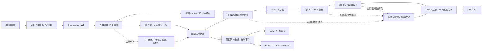

# FPGA 功能整合实施方案

> 2026-10-20执行入口校正：本文P0–P8是设计工作包，不是功能通过记录。`work/integration/`现已存在，其根目录bit与B0恢复包相同；接手时检查差异与输入凭据，禁止按旧“待创建”描述覆盖重建。实际状态见[STATUS](../project/STATUS.md)，命令与脚本局限统一见[工具链](toolchain.md)，任务路由见[Agent工作流](agent-workflow.md)。后文2026-10-16审计事实保留日期边界。

> 日期：2026-10-16。范围：只做工程审计和方案设计，不修改RTL、不运行TD、不生成或下载bit。以下新模块、阶段、预算分配均为计划，不能作为已实现证据。
> 后续执行者使用 superpowers:executing-plans 逐项推进；项目阶段门与软件先行协议优先。本方案不授权跳过用户视觉验收。

**推荐范围和路线**：以 `fallback/project/` 修复候选为母工程，在独立 `work/integration/` 副本推进“原图/Sobel + 安路Logo/显示帧计数 + 单颜色全局框 + 模式/检测状态/坐标/面积OSD”。先关闭G1硬件闭环和G2接口缺口，完成软件预览及用户视觉验收，再接帧元数据和文字。后续依次评估Sobel资源优化、四像素卡通化与区域填充、事件外设、颜色多目标、裁剪INT8 YOLO；YOLO软件研究可提前独立推进。保底版不代替完整作品，不取消既定目标。

**理由**：两套工程共享视频底层、Logo、字库和显示计数；fallback保留了颜色统计、AWB标记、支路对齐、绘框和打包停顿修复，且有可校验恢复包。从Lab3再次移植同一批修复会增加回归风险。当前Slice 75.99%、最差Setup +70ps，需要逐项增加并复核，不能保证所有功能同时装入。

**目标**：保留原工程和当前恢复点，形成分阶段可验证、可回退、可交付的统一无软核工程。

**架构**：保留MIPI/ISP厂商IP、DDR2、HDMI平台边界；DDR前四像素域做算法和统计，DDR帧槽绑定模式/检测快照，HDMI单像素域做OSD，外设消费去重后的检测事件。

**技术栈**：新增应用RTL纯Verilog，既有厂商SV/加密IP保留；TD 6.2.168116、PH1P35MDG324 -3、顶层design_top_wrapper；Python/NumPy/OpenCV/PyTorch、Algorithm Lab、Icarus。

**规范入口**：[PROJECT_GOAL](../project/PROJECT_GOAL.md)、[STATUS](../project/STATUS.md)、[PHASES](../project/PHASES.md)、[验收矩阵](../verification/acceptance-matrix.md)、[软件先行](software-first-protocol.md)、[前次审计](../experiments/2026-10-16-lab3-integration-audit.md)。本轮已读取研究INDEX、OPEN_SOURCE、known-gaps、Goal 1–8阅读清单和既有ADR。

## 1. 工程选择与证据

### 1.1 路径及恢复点

本文路径以仓库根目录为基准，别名用于后文源码定位。

| 别名 | 路径及用途 |
|---|---|
| L | `HX1P35A2026/lab_ex1-3_SC520/lab_ex3_osd_SC520/lab_ex3_osd/`，指定目录下实际工程，保留导入基线 |
| F | `fallback/project/`，整合母工程；不直接在这里继续增加主线功能 |
| R | `fallback/release/industrial-color-bbox-20261014/`及同名ZIP，可恢复构建候选，不是硬件稳定版 |
| W（现已存在） | `work/integration/`，现有R恢复候选的独立副本；工程仍在project/，继续前先核对差异 |
| B0 | R中industrial_color_bbox.bit，SHA-256：C41714E9E960A4C393EAB0444B479F790114750B5E4B76CB9F2512806E7AA470 |

ZIP SHA-256：AB7EBE83F56630D52B1628A732C87AF4E3C56A92D8FD69EE2428096F9D8EF4CA。

选 **F修复源码 + R恢复凭据 + W独立开发**。不选旧卡通工程作母版，不删除fallback路线、不移动现有文件。原始官方分发包和导入目录都保留；L已含检测/调试代码，不能仅凭目录名称其等同未修改官方原包，原始来源以原包和导入清单为准。后续每阶段冻结源码/参数/报告/bit哈希及硬件状态；B1等为计划标签，不是已有Git tag。

### 1.2 本轮重新核实的事实（project）

- Git HEAD为651f9bca3490649afbe1449802d1f3e8ae8df0bf。工作区已有未提交STATUS、fallback状态/RTL修改，以及未跟踪工程、脚本、报告和实验记录；HEAD不能单独代表候选，必须绑定输入清单。
- L有56个显式工程引用，F有57个，F全部可解析。F的.al已移除L保存的旧Project Path，仍用相对引用。唯一构建入口为fallback/build.ps1，测试入口fallback/test.ps1。
- 对F非Runs文件与L对应文件逐字节比较，仅.al、td_project/box_draw_96.v、awb.v、data_96bit_to_128bit.v、isp/color_detect_96.v、isp/isp_top.v不同；F另新增isp/industrial_overlay_96.v。顶层、mixer、Logo ROM、字库、实际import Sobel、管脚、SDC、PLL及其余对应平台内容一致。
- F将.al的isp/data96_128/data96_128.v引用换为修复的hdl_source/data_96bit_to_128bit.v；禁止用目录通配符加入同名或未使用参考模块。
- R的253项manifest长度/SHA-256本轮全部匹配。228项最终构建输入与当前fallback相比仅export.ps1不同，符合构建摘要中的后续导出器修复；其余构建/仿真输入未变，包内实际导出器也通过manifest校验。
- 九组仿真是已有证据，本轮未重跑；ISP接入测试使用上游依赖模型，AWB标记测试禁用增益更新，不能作为厂商IP/实际摄像头/白平衡效果通过证据。

### 1.3 证据索引

以下行号对应本轮文件；代码简写均按F的user_source/hdl_source/展开，另注明者除外。本轮无新增measured证据。

| ID / 类别 | 位置 |
|---|---|
| E01 official | docs/research/snapshots/competition/topic2.pdf，第16页§2.3/2.4、第17页§2.5/2.6、第18页§2.7；本轮重新提取PDF正文 |
| E02 project | F/L的td_project/camera_to_dsi_display.al；F design_top_wrapper.v:442–585,614–824 |
| E03 project | F isp/isp_top.v:48–193，BGGR、AWB、Sobel、模式、检测/绘框及打包 |
| E04 project | F hdmi_mixer.v:471–546,614–624,819–904，Logo、字库、显示计数及输出 |
| E05 project | F isp/color_detect_96.v:25–38,57–100；isp/industrial_overlay_96.v:16–28；F td_project/box_draw_96.v:13–41 |
| E06 project | F video_in.v:40–68,98–138,143–200；video_out.v:43–55,82–166,174–197 |
| E07 project | docs/build/industrial-repair/final/route.qor、final_timing.rpt:8,27–67,101–109、physical-warnings.txt；R reports/camera_to_dsi_display_phy.area:9–38 |
| E08 project | fallback/README.md、test.ps1:15–40；docs/build/industrial-repair/build-summary.md；R manifest/build-summary.json |
| E09 project | work/rtl/video_cartoon_luma.v:1–87；work/algorithm_lab/registry.json；docs/decisions/ADR-001-003-architecture-baseline.md |
| E10 project/reference | archive/legacy/yolo/rtl/conv_pe_int8.v、work/tests/tb_conv_pe_int8.v、archive/legacy/yolo/yolo_fpga_feasibility/report.md、docs/experiments/2026-10-12-y2-microdet.md |
| E11 project | F design_top_wrapper.v:211–212,460–468,621–628,639,812–817；uiisp_beta/ae_set.v:73–120；R area报告的按键位置 |
| E12 project | F td_project/import/edge_detect_96.v:27–52,83–145，实际成对采样Sobel，不能与其他同名文件混淆 |

## 2. 功能与比赛要求映射

“已经接入”只证明实例、连线和工程输入，不等于硬件通过；状态可同时为“已经接入 + 等待硬件验证”。

| 功能 | 要求层级 | 当前状态 | 整合动作与边界 |
|---|---|---|---|
| SC520CS→MIPI→ISP→DDR2→HDMI | 官方基础§2.3(1)(3)，项目主链路 | L/F均已经接入；F有构建，等待硬件验证 | G1先验原图、恢复、帧率；RAW10/BGGR/Lane速率须实物确认（E02/E03） |
| Demosaic/白平衡 | 项目ISP；白平衡对应官方进阶§2.5(5) | 已接入，F修正AWB帧标记，效果待验 | 冻结取位/通道/增益更新，测试光照，不重写厂商基线 |
| 自动曝光 | 官方进阶可选 | ae_set已接，但只是参数/手动增益，无图像亮度反馈 | 完整AE需新增统计、控制及寄存器闭环 |
| 原图/Sobel | 官方至少一种算法§2.3(2)；切换属进阶 | 已接入；F支路对齐修复；硬件效果待验 | 当前横向像素对平均为640采样，再复制结果；不能称全1280采样Sobel |
| 三模式/卡通化/区域填充 | 项目扩展；官方§2.4(1)方向 | F未接；外部模块存在但需要接口适配；区域连通填充需要新增开发 | DDR前96bit/4ppc；色阶量化不等于区域填充 |
| 按键 | 官方进阶，项目三模式要求 | I_button2电平同步后帧锁存；两个I_button调增益 | 当前非已证实的去抖单击循环三模式，须统一分配 |
| 安路Logo | 官方基础§2.3(4) | 已接入160×160 Logo，DEBUG_MODE=0，硬件同屏待验 | 复用ROM/字库，无需另写Logo（E04） |
| 显示帧计数 | 现有演示，不足以证明延迟 | 已接：I_video_user更新32bit计数及6位BCD | 重复旧画面也递增；不是捕获帧数、目标数或延迟 |
| 单颜色全局框 | 官方检测扩展/坐标进阶候选 | L有已知缺陷；F修复版已接，视觉/硬件待验 | 固定阈值；一个全局框；上一捕获帧结果画在下一帧 |
| 模式/检测状态/坐标/面积文字 | 官方检测文字/状态方向；首版目标 | det_*存在但顶层未接，mixer无对应输入；需新增开发和CDC适配 | 面积为命中像素数px，非矩形面积/mm² |
| 类别/多目标独立框/数量 | 项目扩展 | 没有独立对象统计；需新增连通域或检测网络 | 首版COLOR_RANGE/存在状态；目标数“—/未启用”，不能以单框代表1物体 |
| INT8 YOLO-tiny整网 | 项目主线扩展，非官方基础必选 | PE/PC模型/参考算子存在但未接；整网调度/解码/NMS等需新增开发 | 模型效果门未过；裁剪YOLO/Micro-CNN继续评估，不把PC模型当FPGA实现 |
| LED/分拣输出 | 官方应用控制方向、项目扩展 | 顶层没有检测LED/执行器端口；需新增开发 | 有效事件/去重、脉宽、引脚/电气、实物验收 |
| WM8978 | 本轮及AGENTS完整目标 | I2S_receiver/audio_arc_calculate列入工程但未形成播报链，HDMI音频固定0 | 新增Codec配置/I2S发送/PCM；HDMI音频不等于WM8978 |
| 帧率/资源/时序/延迟/恢复/长稳 | 官方稳定性/性能方向；30fps、<2ms为项目指标 | 有资源/STA报告，硬件指标等待验证 | 不凭CNT、文件存在或编译通过判定满足 |

颜色判据为85<Cb<125且135<Cr<200，只适用于与背景可分、光照/增益受控的目标。同色多物、肤色、反光可能合成一框，单点噪声也能使valid_frame=1。该阈值没有固定物体类别，不能识别瓶/杯/手机或直接测毫米。面积下限、形态学、自适应阈值均改变效果，须软件验收。

### 2.1 文档冲突处理

1. PROJECT_GOAL的58.4% Slice及旧ADR“8 DSP、约1008KB BRAM”不作当前预算；用E07的21216 Slice、108 ERAM20K、40 DSP，已占16123/39/25，不修改受保护目标。
2. ADR-002/PHASES固定卡通化DDR前4ppc，优先遵守；DDR后单像素仅作为将来有证据时的变更备选。
3. PHASES把G6检测框依赖G5；当前F单颜色框属独立传统视觉路线。基础整合按F路线增量验收，仍遵守G1/G2正式接入门，不据B1标G3–G6整体通过。主线阶段退出继续按原依赖。
4. PROJECT_GOAL把WM8978写可选，但本轮/AGENTS完整目标包含语音，本方案保留。
5. PROJECT_GOAL规划A4/B4，F实际为A4/N2/J14；B4不在当前顶层作卡通键。先核对实物，不挪用增益键或猜管脚。

## 3. 统一架构与接口

### 3.1 插入位置



颜色检测从AWB原始RGB分叉，不能从Sobel或已画框像素检测。首版保留DDR前黄框，避免同时迁移绘框与缓存；未来同帧检测/多框再迁到HDMI OSD层，并移除前级绘框。各模式尺寸/格式一致，卡通未接入前TOON不可进入。

### 3.2 当前接口账本

| 段 | 数据、每拍像素、同步 | 时钟/复位 | 延迟、缓存与待确认项 |
|---|---|---|---|
| D-PHY→CSI | LANE_NUM=2、BYTE_NUM=1；16bit字节组、hs_valid | S_csi_rx_clk，S_rst_n来自PLL lock | 约束推导103.520MHz，真实Lane速率/CRC/ECC待核对 |
| CSI→RAW | 32bit payload→40bit/4个RAW10，frame_start/end、valid | 同MIPI域 | 包重排周期待测；旧RAW8注释不作格式依据 |
| uial2axis→Demosaic | 40bit/4ppc，tvalid/tuser/tlast，1280×720 | 同域 | 顶层tdest悬空，不能认定完整AXIS；BGGR仅配置 |
| Demosaic→AWB | 128bit四槽转96bit：{[23:0],[55:32],[87:64],[119:96]}；lane0=[95:72] RGB888 | 同域 | data_complete_delay=50不是总延迟；缓存/增益实际总周期待测 |
| AWB→模式 | 96bit/4ppc，控制随寄存器 | 同域 | AWB后1拍+Sobel1拍，原图2拍；AWB tlast在valid下降后出现，不假定末像素同拍 |
| Sobel | 4像素→2平均采样→2边缘值各复制2次，阈值80 | 同域 | 输出寄存1拍；历史2行，前2行/行首组屏蔽；空间因果偏移另计 |
| 统计/绘框 | 96bit，4×11bit坐标、20bit命中面积、存在标志 | 同域 | 最后一组经q_end发布；视频延迟2拍+绘框输出1拍；SOF取上一捕获帧结果 |
| 96→128→写FIFO | 4组96→3个128bit字；240字/行、172800字/帧；SOF可独立valid | MIPI→DDR异步FIFO | 停顿保留半包，无ready；宽度需16倍数；128bit不是4个RGB888 |
| DDR用户口 | 128bit，每字地址+8，240字突发，wr/rd/ready | S_ddr_clk，usr_clk报告66.667MHz | 四基址0/7000000/14000000/21000000为控制器单位，不能直接称字节；完成语义待确认 |
| DDR→video_out | 128bit FIFO→24bit/1ppc；每16像素在计数0/5/10读3字 | DDR→HDMI域 | 延迟含FIFO模式/寄存器须波形确认；行消隐重置拆包 |
| VTC/mixer→HDMI | 24bit/1ppc，DE/HS/VS，user帧脉冲、last独立生成，rd_en=DE | 像素约75.002MHz、串行375.094MHz | mixer同步3拍，rd_data至输出3拍；请求/数据/坐标整体对齐待证实 |
| 卡通候选 | 外部video_cartoon为24bit/1ppc、VS高有效、HS/DE，无背压 | 独立候选域 | 源码6级，登记册估计4拍不可沿用；4ppc需重新设计跨lane窗口和延迟 |

**背压**：S_ISP_O_tready顶层未见驱动，isp_top的awb_O_tready未见赋值；现处理主要按valid推进，不得把端口名当可靠握手。写FIFO full/afull、读FIFO empty未形成完整保护，I_mipi_rx_error绑0。P0/P2确认实际依赖，定义“valid即消费、不能反压摄像头”和溢出/欠载/短帧失效，不能随意tie-high掩盖问题。

**时钟复位**：50MHz经PLL产生100MHz、约23.810MHz、HDMI像素/串行；DDR IP另生用户/DDR时钟，MIPI来自接收。I_rst_n复位PLL，lock直接驱动S_rst_n/S_hdmi_rst_n；摄像头启动有独立延时。新增模块本域同步释放复位；单域复位清握手/队列，epoch隔离旧结果。平台复位树若须修改，独立修复并保存报告，不混入OSD提交。

### 3.3 帧元数据：解决最新结果与实际显示帧错配

首版选择**保留次帧绘框，传送与烧入框完全相同的快照**，明确其来源帧。逐bit双触发器同步坐标、仅同步det_valid、HDMI VS读取最新det_*都不可接受。

拟定首版消息契约：

| 字段 | 位宽和语义 |
|---|---|
| epoch | 16bit会话代次；复位握手清队列完成后才恢复发布，不能单靠计数值避免旧包 |
| capture_frame_id / result_frame_id / draw_source_frame_id | 各32bit，分别标识像素画面、统计结果来源、实际绘框来源 |
| slot / slot_generation | 2bit槽号 / 32bit代次，区分四槽回绕 |
| mode | 2bit：0 RAW、1 EDGE、2 TOON、3非法；非法退RAW并报错 |
| result_status | 3bit：INIT、VALID、EMPTY、STALE、ERROR，与存在标志分开 |
| target_present / count_valid | 各1bit；首版count_valid=0 |
| xmin/ymin/xmax/ymax / area | 4×11bit闭区间坐标、20bit命中像素数；空场全0 |
| detector_kind / color_label | 各8bit；首版COLOR_RANGE，不是物体类别 |
| object_count | 16bit预留；count_valid=0不显示数字，禁止由target_present合成数量 |

合计249bit，封装为256bit，未用7bit固定0；多框列表将来单独存储，不能把可变数组逐bit跨域。

1. 捕获SOF分配frame_id，只有完整帧统计才生成result_publish脉冲；valid_frame只是存在电平。半帧、FIFO错误和复位中断不发布可执行结果。
2. 在box_draw实际锁存的SOF，同时保存绘框坐标/面积/存在标志、mode和draw_source_frame_id；文字必须用该组快照。首版capture_frame_id与draw_source_frame_id通常相差1；首次无结果为INIT。
3. MIPI→DDR使用整组异步FIFO，首版建议8×256bit。写槽绑定由video_in实际SOF/地址选择事件产生，不猜自增指针；当前S_video_in_wp同沿自增而地址使用旧值，按非阻塞赋值语义验证。
4. DDR域维护4槽metadata表。像素帧完整、无错误、命令/数据可靠接受后才置slot_complete。若无写完成响应，必须追到mc_to_user_interface队列、排空及读写顺序保证，定义可审计条件，不能以最后camera_valid代替DDR完成。
5. video_out实际选择读基址时锁存slot/generation，取对应快照，通过第二条8×256bit异步消息FIFO送HDMI pending寄存器；首个有效显示像素前提交active。读槽选择来自反相VS的消隐事件，不能等I_video_user首像素才开始跨域请求。
6. active整帧不变；HDMI重复旧帧时快照也重复，显示CNT继续增加，检测事件不重发。快照晚到/缺失显示STALE并屏蔽数字/动作，不沿用别槽最新结果。
7. 证明读帧期间该槽不被覆盖。先仿真四槽相位/速率并实测；若现调度不能保证，独立增加最小槽所有权修复（FREE/WRITING/COMPLETE/READING），保留DDR IP/地址布局。必要时合法丢弃整帧并报告，不能半帧覆盖，也不能把有丢帧设计称无丢帧。
8. 消息FIFO满不反压摄像头：该帧元数据失效、错误计数增加、清slot_complete并禁止事件。任一域复位清队列与握手；frame_id/代次回绕按模运算并限制比较窗口。

后续同帧框：采集N的干净像素和完整统计绑定同槽，HDMI读N时按N绘框。YOLO晚到结果只能匹配相同frame_id并保留相应画面，或显式标滞后；不能把N-k框当N。增加保帧会增加缓存/延迟，需独立预算及视觉验收。

## 4. 模式、OSD与外设事件规则

### 4.1 按键与模式

首版保留I_button2=A4现有RAW/EDGE电平语义，同步/去抖后形成请求；I_button[0]=N2对应增益减、I_button[1]=J14对应增益加，保持现用途。以上为ADC/area工程位置，实物丝印待核对。

三模式阶段按PROJECT_GOAL的A4边缘、B4卡通设计请求；确认B4板级可用后才接入。如果不可用，提交具体改键提案由用户决定，不默默挪用增益键。候选交互为TOON优先、全部释放回RAW、去抖20ms、长按不重复触发，先在软件预览展示并冻结；这些并非已实现行为。

请求跨域用握手，只在捕获侧对齐SOF应用；显示标签读取对应DDR槽的mode，不读当前按键电平。RAW/EDGE/TOON补齐相同延迟，模式切换不中断检测统计。手动增益变化后重新积累有效检测帧，参数版本纳入实验记录。

### 4.2 首版OSD

复用左上160×160 Logo和现有“安路CNT”数字，说明其为显示帧计数。新增信息区候选y≥176，避开Logo和既有计数，最终位置在用户预览验收时冻结：

- MODE：RAW / EDGE；TOON待实现。
- DET：INIT / COLOR_HIT / EMPTY / STALE / ERROR。
- BOX：(xmin,ymin)–(xmax,ymax)；AREA：命中像素数px。EMPTY为0/空框，STALE/ERROR为“—”。
- CAP / RESULT / AGE：捕获帧、绘框源帧及帧龄，明确次帧统计。
- CLASS：COLOR_RANGE或“未分类”；OBJECTS：“—/未启用”。多目标/YOLO通过后才显示实际类别/总数。

首版黄框已烧入视频，Logo/原计数/新文字按固定优先级叠加；遮挡行为在预览验收。数值转BCD在消隐或消息到达后迭代完成，每帧原子切换字符缓冲，不在像素组合路径堆除法或大case。将来HDMI绘框位于文字/Logo下层，不将字符像素送回检测。

### 4.3 结果、显示和动作分离

区分result_publish（完整采集结果）、display_commit（对应画面实际呈现）、detect_event（稳定判定后的单次事件）。OSD消费display_commit；外设从result_publish经过事件状态机触发，携带epoch/result_frame_id/event_id，可追溯但不为显示等待延后分拣。

拟定事件策略：连续3个不同完整捕获帧满足面积门槛/ROI且新鲜才触发；持续存在不再触发；连续3个完整EMPTY帧重新武装。A_min、ROI、最大允许帧龄须在工位预览前冻结，未配置则外设禁用。这些次数是设计建议，不是测得值。

短帧、过期、队列溢出、初始化、非法模式、复位均禁止动作并撤销待执行事件，恢复后重新积累完整新帧。LED建议显示有效事件已接受的200ms可见脉冲；分拣输出单独定义极性/延时/脉宽，须执行器电气资料，不能沿用LED时长驱动电机。无目标/复位/错误保持无动作。

首版单框只适合单件依次进入ROI；同色多件不能可靠分拣计数。累计通过量需对象关联/过线去重，与当前画面目标数分开。

语音同一event_id只排队一次，播放中不重启；有界队列满丢弃新语音并记overflow，不拖停视频/分拣。复位立即静默清队列，过期事件不补播。WM8978需控制I2C、MCLK/BCLK/LRCLK、I2S TX、PCM ROM/外存；采样率、字宽、声道、功放和引脚由手册/原理图确认，现I2S_receiver不能代替发送链。

## 5. 资源、吞吐与延迟预算

### 5.1 当前基线和增量门

| 项目 | 最终交付报告（E07） | 设计结论 |
|---|---:|---|
| Slice | 16123/21216，75.99% | 物理剩5093；满足严格<80%最多16972，即只可净增849，不是可随意耗尽的预算 |
| LUT6 / 寄存器 | 13954 / 14349 | 按同一TD报告比较，不能混用赛题LUT口径 |
| ERAM20K | 39/108 | 名义剩69块，按20×1024bit计算176640B；端口/银行/碎片会减少有效容量 |
| DSP | 25/40 | 只剩15；旧其他变体“剩32DSP”不能用于本工程 |
| Setup/Hold WNS | +70ps/+20ps，TNS均0 | 最差在Sobel；HDMI域Setup也仅+104ps，新增OSD同样有风险 |
| STA覆盖率 | 95.92% | 未覆盖路径和时钟告警待审计，不等于完整时序签核 |
| 视频FIFO | 读写各128bit×512配置 | full/empty保护及实际峰值占用待测，容量不证明无丢帧 |

初始**设计上限而非资源预测**：B1元数据+文字OSD净增≤500 Slice、≤2 ERAM、0 DSP，在80%线前保留至少约349 Slice机动。超预算先检查字库推断、BCD、寄存器和Sobel存储映射，不删除要求功能或放宽80%。增量以同输入/约束构建差值记录，孤立综合不能代表整合布局。

4×256bit元数据表原始容量1024bit，两条8×256 FIFO合计4096bit；握手寄存器、灰码、端口映射另计，不能由bit数直接保证RAM块数。后续多框初始K=8仅是软件候选，不是获批上限；噪声最坏连通域数及溢出行为必须定义。

Sobel两行理论存储2×320×16=10240bit，但异步读数组的关键路径含DRAM/LUT；ram_style标记不证明BRAM推断。先做数学等效的同步RAM/梯度分级实验，原图和控制等长延迟；测得收益后才能分配给卡通/YOLO，不能提前授予G7创新通过。

卡通/区域填充/连通域/WM8978/YOLO的Slice、DSP、Fmax增量均**待测**。单像素卡通两行RGB逻辑容量2×1280×24=61440bit；4ppc需银行/跨组访问，不能简单复制4套完整滤波器或把行缓存容量当总资源。PCM容量=采样率×样本字节×时长×声道，必须和视觉共享预算。

### 5.2 带宽（inferred，非实测）

1280×720=921600像素/帧，RGB888为2764800B/帧；96bit流230400有效拍/帧，128bit打包172800字/帧。

30个新帧/s：27.648Mpixel/s、6.912M个四像素有效拍/s，写DDR至少82.944MB/s；60fps写165.888MB/s。

报告HDMI像素时钟75.002MHz，VTC总1650×750，因此名义刷新率约60.6077Hz，有效视频读带宽约167.57MB/s。输入30fps+当前显示速率，读写合计约250.51MB/s；输入60fps则约333.45MB/s。未含刷新、读写切换、命令间隙、排空、推理流量，不能把项目30fps代入两个方向。

128bit×66.667MHz用户口峰值约1066.7MB/s，仅是每拍接受的数学上界。实际共享仲裁，须统计ready/命令接受/返回字数/最大服务间隔/FIFO高水位，给平均有效吞吐和最坏阻塞，不能拿峰值证明充足。

MIPI四像素瞬时容量4×103.520MHz，上游有效拍有突发；单像素同钟串行化只能消费1/4峰值，没有输入间隔≥4拍证据，故按ADR设计真正4ppc接口。传感器唯一帧率、HDMI刷新率、检测更新率分别测量。

### 5.3 YOLO预算与算法范围

没有已批准可直接硬件化整网。6988参数MicroDet公开测试效果失败；PC YOLOv8m约25.9M参数仅作视觉参考。保留裁剪YOLO/Micro-CNN研究方向，不以失败小模型充当完成品。

每个候选输出逐层表：输入/输出形状、kernel/stride/padding、MAC、INT8权重及bias/scale、活跃张量峰值、银行/端口、周期、访问量、误差。首轮算力探索4或8 MAC/拍，100MHz仅是预算变量；8 DSP各做1 MAC则总DSP至少33/40，未含其他量化控制，不预设双乘有效。

理想计算时间=MAC总数/(有效并行数×频率×利用率)，再分析不能重叠的搬运/调度/后处理。30fps、8MAC、100MHz、100%利用率理论最多26.67M MAC/帧；16MAC若每DSP一个则已超当前剩15DSP，需先优化或证明其他映射。

现有FastestV2例为106382232 MAC/352帧，单张INT8特征743424B；16MAC/100MHz理想66.49ms，8MAC理想132.98ms，均非30fps方案。参数粗下界243095B超过176640B名义空闲ERAM。E10的算量可参考，资源必须替换为当前F预算；不能把旧变体32个空闲DSP搬来使用。增加DDR推理前须验证视频共存带宽及最坏仲裁。

模型冻结内容：架构/权重哈希、数据及校准/独立测试划分、RGB顺序/ROI/缩放、每层scale/zero-point、舍入/饱和、激活和累加界限。现有PE仅移位重定标/ReLU，valid_out与clr_acc相关，需审计末次累加排空、bias/shift时序，不能覆盖任意PyTorch量化图。

硬件链必须包含纯Verilog层调度FSM、卷积、池化、激活/重定标、特征RAM、候选框解码和有界NMS；CPU软件NMS不计硬件完成。冻结排序/tie-break、IoU比较、类别处理、候选上限、溢出策略，测试零面积/同框/同分/阈值边界。

### 5.4 延迟及<2ms缺口

分别报告像素算子周期、采集对应像素至显示的端到端时间、完整检测帧延迟、事件至动作延迟。四槽轮转、上一帧绘框及独立显示相位引入帧级等待，首版不能承诺<2ms；局部数拍不能代替帧缓存等待。

保留<2ms目标，设独立可行性/优化门：追踪slot/frame_id与缓存读写时间线；同一参考时基记录捕获/显示时间戳并整组跨域，或外部高速光学记录同一事件。报告起止定义、误差、最小/中位/P95/最大值；光学法包含曝光/屏幕扫描，内部时间戳不涵盖全部光学链路。若现缓存策略结构性无法达成，提交低延迟缓存改造提案，不改写为“仅算法<2ms”。

## 6. 按依赖划分的实施阶段

P阶段是工作包，不替代G1–G8。视觉新增或变化严格执行A检索评估→B软件→C用户明确VISUAL_APPROVED→D硬件等价→E RTL仿真→F TD→G真实上板。已有B0的visual_approved=false，本文不追认。每次失败保留首个失败证据，不放宽测试或目标。

**审查重点**：首/末像素与跨字拆包错位（P2/P3）；帧槽回绕/重复显示/消息晚到（P2）；单域复位旧事件重放（P2/P5）；多物同色/空场噪声误计数（P1/P6）；固定点溢出与推理拖停视频（P7）。每项在对应阶段列出测试。

下文W表示work/integration；H表示W/project/user_source/hdl_source。所有“新增/修改”都是后续执行任务，本轮未实施。

### P0：恢复点、硬件基线与接口账本（第一阶段）

**前置**：本方案；不需要新算法或新bit。

**文件**：新增docs/evidence/integration/b0-manifest.json、b0-bringup.md；docs/architecture/sc520-interface-contract.md、integration-frame-contract.md；据证据更新STATUS/known-gaps。后续执行时创建W源码副本和W/README.md，保留L/F/R。

- [ ] 重验R bit/ZIP与253项清单，固定工具路径和输入版本；区分Lab1原图、B0工业和历史卡通候选。
- [ ] 重新枚举下载器并核对板卡、模组、接线；先用已有可追溯Lab1原图基线完成G1-H。B0单独冒烟，不以含算法B0替代G1原图范围。
- [ ] 冷启动/热复位/下载各3次、连续30min，记录启动时限、分辨率、HDMI刷新率及唯一新帧率、MCLK/I2C状态与异常；全部绑定位流哈希。
- [ ] 归类PHY-5060/5016/5079/5088及95.92% STA覆盖缺口，列端点/原因/关闭证据。G1-B两次干净构建不足时，列独立后续补建任务；本轮不触发新bit。
- [ ] 填第3节账本，重点确认ready悬空、SOF/valid、DDR写完成/读槽/覆盖、FIFO模式、复位释放。无法证明的填unknown并给取证方法。

**验证/退出**：恢复清单无差异、文档可审查可作为P0审计交付；进入正式RTL整合必须G1-B/G1-H及G2依赖接口通过。无硬件时P0硬件项保持阻塞，不声称G1通过。

**回退**：L、现有Lab1、B0不变。W是可弃用副本，源恢复点不覆盖。

### P1：首版软件预览和协议冻结

**前置**：F源码行为已审计。可与P0只读/硬件准备并行；不依赖新RTL。

**文件**：新增work/algorithm_lab/plugins/integration_preview.py、tests/test_integration_preview.py、configs/integration_v1.json；修改work/algorithm_lab/app.py、static/index.html、registry.json；记录docs/experiments/integration-p1-preview.md。继承现有BaseAlgorithm接口：process_visual_reference(image_rgb, params)和process_hardware_equivalent(image_rgb, params)返回(output_rgb, metrics_dict)，输入HxWx3 uint8 RGB，不另建孤立平台。

- [ ] Stage A复用OPEN_SOURCE已评估参考并核对许可证；无License只借鉴思想。登记实际像素对Sobel、颜色阈值、Logo资产与OSD布局。
- [ ] Stage B展示原图/Sobel、mask/全局框、文字以及视频序列“上一帧框画在下一帧”。覆盖静止/移动、两个同色物、空场、反光、光照变化；不能拿现单像素Sobel模型冒充F实际算法。
- [ ] 展示显示CNT、CAP/RESULT/AGE和OBJECTS未启用；冻结按键行为和布局。测试test_area_is_mask_count（两个分离块只有全局框，area为像素和）、test_empty_clears、test_display_repeat_no_new_event、test_mode_matches_frame。
- [ ] Stage C请用户审查具体样本/参数，获得明确批准再登记VISUAL_APPROVED及代码/样本/参数哈希。旧cartoon v1.0-test只覆盖历史s3_luma参数，不覆盖本轮颜色/OSD/新卡通。
- [ ] Stage D在批准后完成Q10、四lane、边界/停顿、整数面积、次帧快照模型，导出Golden向量/差异图；提前冻结误差标准。

**验证**：新增后从仓库根运行python -m unittest discover -s work/algorithm_lab/tests -p test_integration_preview.py -v；实际HTTP图片/视频预览、参数对比及导出。既有测试按实际入口回归。

**退出**：软件可运行、数值/计数无误标、用户明确视觉批准、硬件等价模型通过。四项分别记录，不以测试替代用户确认。

**回退**：Algorithm Lab原代码/参数快照；硬件B0不变；效果否决回Stage B。

### P2：帧槽元数据、CDC与两模式控制（B1前半）

**前置**：G1/G2已通过；P1 Stage C/D通过；写槽完成与读槽所有权可证明。保留DDR IP配置。

**文件**：修改H/design_top_wrapper.v、isp/isp_top.v、isp/industrial_overlay_96.v、video_in.v、video_out.v；新增H/integration/frame_metadata_cdc.v、frame_metadata_store.v、mode_control.v；更新W/project/td_project/camera_to_dsi_display.al、W/test.ps1、input-manifest.ps1；新增W/tests/tb_frame_metadata.v、tb_mode_control.v。

**输入/输出**：输入捕获SOF、完整结果、实际写/读槽选择及完成事件；输出256bit active_meta、metadata_ready和error_count。mode_request只在捕获SOF生效，mode随画面进入帧槽。

- [ ] 先建立三异步时钟测试：四槽回绕、重复/跳过显示、消息晚到、SOF同拍/提前、丢半帧、各域单独复位、FIFO满、读写碰撞。断言active整帧不变、generation不误配、旧epoch无事件。
- [ ] 按3.3节实现两条8深度消息队列、4槽表、slot_complete、读帧锁存。导出真实读槽而非固定延迟猜帧。
- [ ] 对CDC给协议、约束和复位证据；审计既有异步clock_groups，不增宽泛false path。
- [ ] 若需要所有权修复，独立提交最小改动、独立地址/队列测试并重跑G1相关回归。否则保留当前调度，仅增加观测/元数据。
- [ ] 在W运行现9组回归和新增测试，保留依赖模型范围；像素字数与帧标识逐项比对。

**退出**：帧/槽/模式零错配，错误有明确失效处理，无已知部分覆盖问题；尚不能称可演示。

**回退**：B0；P2开发快照不是硬件稳定版。

### P3：统一OSD与首个演示版本B1

**前置**：P2通过，P1视觉批准仍对应当前内容/语义。

**文件**：修改H/hdmi_mixer.v、osd_char_lib.v、design_top_wrapper.v和.al；新增H/integration/detection_osd.v、binary_to_bcd.v；新增W/tests/tb_detection_osd.v、tb_integration_video.v；新增docs/experiments/integration-b1.md、docs/evidence/integration/b1/。

- [ ] 按P1布局生成像素Golden；测试999999显示计数回绕、EMPTY/STALE/ERROR、最大坐标1279/719、面积921600，以及首/末像素和整帧原子更新。
- [ ] 将active_meta接入HDMI域，消隐准备BCD，文字/像素/DE/HS/VS/坐标同延迟。复用Logo/CNT，不用改VTC/PLL掩盖OSD错位。
- [ ] 用完整带frame_id图案经过DDR模型→video_out→mixer逐像素比较，特别检查0/5/10跨128bit边界、首行首像素、帧开始FIFO清空与第一批数据；不能只测检测器。
- [ ] Stage E全通过后用W/build.ps1唯一入口构建，保存完整日志、area、route.qor、timing、输入清单。Setup/Hold≥0、TNS=0、Slice<80%且满足冻结增量预算，关键告警须解释并关闭。
- [ ] 上板同屏检查原图/边缘、Logo/CNT/黄框/文字；移动/空场撤框、按键切换、复位；边缘观察至少10min、首版连续30min冒烟，完整长稳留P8。

**退出**：文字与烧入框使用同快照，模式与实际显示帧一致；效果获用户确认，硬件记录绑新bit哈希，才称B1最小可演示版。G3–G6不自动通过。

**回退**：B0。B1通过后冻结完整包，后续从新工作快照增加功能。

### P4：Sobel资源优化、四像素卡通化与三模式B2

**前置**：B1；新效果独立通过A/B/C/D。保持DDR前4ppc决策和正式阶段依赖。

**文件**：修改W/project/td_project/import/edge_detect_96.v、H/isp/isp_top.v、integration/mode_control.v及OSD；新增H/isp/cartoon_96.v、window_3x3_4ppc.v、region_fill_96.v；新增W/tests/tb_sobel_96.v、tb_cartoon_96.v；扩展work/algorithm_lab/plugins/cartoon.py、相应模型/向量及registry。

- [ ] 先做同数学行为的Sobel同步BRAM与分级梯度优化，原图/控制等长延迟。窗口、四边四角、连续帧、停顿/复位对照；若改为全分辨率Sobel，先重新视觉验收。
- [ ] 做真正4ppc窗口/量化/轮廓，覆盖lane3→下一组lane0、行边界、短帧；选用户批准s3_luma或新方案，不能把6拍单像素候选直接连96bit流。
- [ ] 区域填充先冻结连通性、边界、代表色、最坏噪声；需要跨行/帧传播时独立预算缓存/延迟。量化+描边子版本可单独演示，但不计完整G3；局部平滑不替代区域连通填充。
- [ ] 核对B4实物后加入TOON，三支路补齐延迟；黄金模型像素/控制比对、综合资源/时序、三模式实测和切换回归。
- [ ] 按PHASES补齐G3，再完成G4正式退出记录；局部Sobel测试提前完成不等于G4提前通过。

**退出**：含区域填充的完整卡通和三模式通过软件、RTL、TD、硬件，资源/时序有证据；不足就保留未完成项。

**回退**：B1；色阶子版本不得标完整B2/G3通过。

### P5：检测事件、LED、分拣与WM8978，B3

**前置**：检测与事件规则获视觉/行为确认，原理图/执行器/Codec资料及PCM预算闭合。B1后可准备资料和事件软件；完整G6退出仍按G4/G5依赖。

**文件**：新增H/integration/detection_event.v、H/peripherals/sort_output.v、wm8978_init.v、i2s_tx.v、voice_player.v；新增W/tests/tb_detection_event.v、tb_peripherals.v；有板级证据后修改顶层/pin.adc/SDC/.al，音源和ROM配置纳入清单。

- [ ] 测试3新帧确认/3空帧解除、重复显示不重触发、旧epoch/错误/短帧取消、增益变化后重积累。
- [ ] LED和分拣分别验证极性/脉宽/时限/复位无动作；核对外接驱动后再接真实负载。
- [ ] Codec初始化逐寄存器ACK/超时，I2S位宽/声道/采样边沿比对，PCM容量、队列满、播放中复位、无目标静默测试。
- [ ] 与视频并行运行，验证不改变DDR服务和视频稳定性；保留动作/音频波形和事件ID。

**退出**：同事件只执行一次，断流/复位/空场无动作，声音与事件一致，资源/时序/硬件证据齐全；分项可交付但不取消语音。

**回退**：B2或最近已通过版本，外设默认无效。

### P6：多目标颜色检测与统计，B4

**前置**：B1协议、工位范围/计数规则冻结，A→D通过；可独立于YOLO软件，但不得替代YOLO目标。

**文件**：新增work/algorithm_lab/plugins/color_components.py；H/isp/components_96.v、integration/object_result_bank.v、box_overlay_24.v；W/tests/tb_components.v、tb_multi_box.v；修改分叉、列表metadata与OSD。

- [ ] 软件比较形态学+连通域、降采样bitmap/run-length；记录遮挡/接触合并、最小目标尺度和采样误差，冻结邻接规则、K上限和溢出行为。
- [ ] 完整结果双bank原子切换，整组传列表generation；绘框移到HDMI时移除前级黄框，同帧匹配或显式滞后，重新视觉验收。
- [ ] 测试0/1/多目标、全噪声最坏组件数、贴边/合并/分离/溢出；当前目标数与累计分拣量独立，过线/关联去重单独验证。
- [ ] 实测资源、最坏处理时间、数量/定位误差；超候选容量必须报错，不能静默把截断数当真实总数。

**退出**：预设工位指标、最坏吞吐、上板及时序通过；不能把全局框升级为多目标仅靠接线。

**回退**：最近通过的B3/B1功能快照。

### P7：裁剪INT8 YOLO整网，B5

**前置**：工位类别/精度/误报/延迟指标冻结，数据按场景/拍摄批次隔离；模型VISUAL_APPROVED、逐层定点等价、算力/存储预算GO；G1/G2/G3和相关主线门通过。

**文件**：新增W/models/yolo/模型描述、量化JSON、权重/校验、逐层向量；H/yolo/roi_resize_96.v、conv_engine.v、pool_engine.v、requantize.v、tensor_store.v、inference_fsm.v、box_decode.v、nms.v及W/tests对应算子/整网测试。评估并适配archive/legacy/yolo/rtl/conv_pe_int8.v，不覆盖原候选；扩展Algorithm Lab及registry。

- [ ] 软件效果先过门，冻结架构/训练/量化与独立测试；按5.3逐层预算。没有合格模型就停在软件研发，保留失败原因，不编写伪完整网络。
- [ ] 隔离验证MAC、INT32累加、池化、激活/重定标、RAM端口和排空；其后TD最小实验确认DSP映射/ERAM/Fmax，不把孤立结果当视频并行通过。
- [ ] 纯Verilog FSM执行层序、ROI缩放、padding、缓存复用；小样本整网逐层对照定点模型，覆盖复位、停顿、极值溢出。
- [ ] 实现硬件解码/NMS/类别/数量，同分排序、零面积、阈值边界、空场/多目标/帧末发布；frame_id贯穿到OSD/事件。
- [ ] 视频优先仲裁；推理赶不上时有界丢弃推理输入并显示统计，不停视频、不把检测fps当视频fps；若既定指标达不到则不通过，不自行降低目标。

**退出**：G5完整验收及三模式/外设并行回归通过，报告精度、误报、计数、更新率、P95/最大延迟与失败边界。

**回退**：最近完整基础版本；模型NO-GO不删除目标，继续训练/裁剪研究或提出用户审批的目标变更。

### P8：量化优化、冻结及发布，B6

**前置**：全部既定功能和阶段门通过、G6稳定；B1不等于此前置成立。

**文件**：docs/experiments/optimization-baseline.md、docs/evidence/integration/b6/、docs/release/及版本化release包；操作手册、比赛映射、演示脚本、PPT/视频索引。

- [ ] 选2–3个真实有效优化，同输入/工具/约束单变量比较；资源、WNS/Fmax、帧率、各段延迟、精度/误报、恢复均报告。
- [ ] 冻结源/模型/参数/IP/约束/bit哈希，从包干净重建；另一队员按手册搭建，事前冻结搭建时限。
- [ ] 冷启动/热复位/下载各10次、连续4h、完整演示3次；全时段记录FIFO/锁相/丢帧/计数/音频/执行器异常与恢复，复跑受影响G3–G6回归。

**退出**：G1–G8证据与冻结包一致，<2ms等指标实测通过；未达标继续标未完成，不能宣称完整作品可提交。

**回退**：最近通过的冻结包，失败记录保留。

### 6.1 执行命令和构建纪律

本轮不执行以下命令；列为后续门禁满足后的入口。在仓库根，以明确工具目录调用W副本：

```powershell
powershell -NoProfile -ExecutionPolicy Bypass -File .\work\integration\test.ps1 -IcarusBin 'E:/Projects/FPGA/.tools/iverilog/bin'
powershell -NoProfile -ExecutionPolicy Bypass -File .\work\integration\build.ps1 -TdRoot 'E:/Projects/FPGA/.tools/td/app'
```

W为独立整合副本，不能依赖脚本按父目录猜工具位置，实际安装路径在P0核验。每阶段先更新显式.al及输入清单，测试入口补入新增testbench并明确PASS断言；原9组覆盖继续保留。build.ps1会清理本副本Runs，必须确认目标在W内，不对L/F/R运行清理。测试、构建与导出都绑定同一输入；负WNS、非零TNS、测试失败或源变更拒绝导出。既有脚本时序门不足以代替视觉/关键告警/硬件门。

## 7. 最小演示、完整目标和未知项

**B1最小可演示**：实时视频、原图/现有Sobel、Logo、显示帧计数、颜色全局黄框、MODE/DET/坐标/命中面积/帧龄。必须有真实下载、同屏效果、空场撤销、模式帧一致性、恢复和30min冒烟的哈希证据；不能从已有bit直接认定官方基础已满足。明确上一捕获帧框滞后，不宣称动态精准跟踪、多物计数或<2ms。

**B6完整目标**：三模式及区域填充、可追溯裁剪YOLO整网、类别/多框/总数、LED/分拣/WM8978、资源余量、帧率/端到端延迟/复位长稳和可独立重建交付。传统颜色检测保持独立选项，不冒充神经网络，不删除恢复路线。

当前不能保证：任意光照/背景下颜色准确、多同色物独立框、现成YOLO适合工位、所有模块同时容纳、新OSD仍保持正时序、四帧槽达到<2ms、当前输出已是30fps、任一候选已通过硬件长稳。

| 缺口 | 取证方式/下一动作 | 阻塞范围 |
|---|---|---|
| G1成功版本、接线/启动恢复、时钟告警 | 重新枚举下载器，原图基线下载，MCLK/I2C/帧时序及绑定视频 | 正式RTL整合，不阻塞软件预览 |
| 30fps目标与约60.61Hz配置差异 | 分测唯一捕获帧率/显示刷新率；独立提交配置调整依据 | 性能验收，本轮不改PLL/寄存器 |
| ready/SOF/FIFO/短帧 | 接口审计、厂商FIFO时序模型和错误路径测试 | P2 |
| 四槽完成/覆盖/metadata | frame_id/地址/命令队列仿真和板上计数 | P2/P3，不以固定延迟猜帧 |
| 扩展视觉批准 | P1可运行对比后，用户明确确认并绑定版本/参数/样本 | Stage D/E/F |
| A4/B4、LED/执行器/WM8978 | 原理图、型号、电平、引脚和Codec配置核对 | P4/P5；B4不可用时才请求改键 |
| 工位与检测指标 | 物体/尺度/光照/物距、独立批次素材；冻结Recall/Precision/空场误报/计数/延迟 | 完整应用、YOLO硬件化 |
| 资源与低延迟 | 同约束小步实现、DDR最坏服务间隔、时间戳/光学测量 | B2–B6承诺 |
| 许可及原包来源 | 固定commit/许可快照、原包导入清单；无许可只借鉴思想 | 新代码引入/交付 |

本轮没有必须由用户立即决定才能完成方案的事项。下一轮先P0恢复点/硬件输入与接口账本，同时做P1交互预览；到视觉验收时再集中确认具体效果、工位参数和指标。本文不修改PROJECT_GOAL、PHASES、acceptance-matrix或AGENTS。

## 8. 本轮交付核验

本轮仅审计源码实例、.al、报告、官方PDF和既有实验；未跑TD/bitgen/下载，未重跑RTL仿真。已重验R的253项清单、bit/ZIP哈希、F的57个显式工程引用、L/F差异及228项构建输入，导出器历史差异单列。

对所审计L/F/R中的501个RTL/IP/约束/工程/bit建立内容快照，文档写入后复核不变。交付只新增本方案，并向known-gaps追加尚未闭合项，保留用户其他修改。检查文档链接、预算算式、需求覆盖；拟创建文件明确为计划路径。以上验证只代表审计/文档一致性，不代表硬件验收通过。
