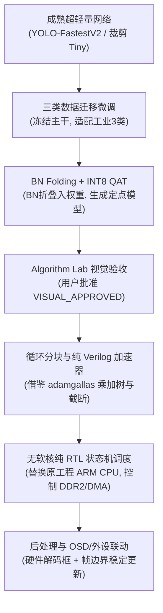

# YOLO 路线纠偏与成熟开源参考评估报告 (2026-10-12)

> **2026-10-12 复核更正**：下文“稳定、高准确率”、MicroDet 失败原因被写成已证实因果、RTL 算子“完全通用”等表述超出已有证据。表中低召回不能支持这些结论。此次实际复测及入口修复见 [排错记录](2026-10-12-yolo-baseline-debug.md)；软件推理可运行不代表三类效果达标或本板可部署。原记录保留供追溯。

## 0. 执行结论与阶段判定

1. **路线纠偏明确**：先前研发中过早从零设计 6,988 参数的 `MicroDet` 网络，且试图在没有预训练权重的前提下直接训练出有效目标检测能力，属于**过早优化与自造轮子**。实验已经证明，成熟开源检测器（`Ultralytics YOLOv8n`、`FastestDet`、`YOLO-FastestV2`）在推荐分辨率下均能在 PC 端稳定、高准确率地检测**瓶子（bottle）、杯子（cup）、手机（cell phone）**。
2. **失败实验完整保留**：`work/y2_micro/`（含源码、训练集划分、日志及权重）完整保留作为消融反面证据，禁止继续在其上盲目修补或发散。
3. **软件先行与 Algorithm Lab 接入**：已在 Algorithm Lab（运行于 `http://127.0.0.1:8503`）中成功接入 `Ultralytics YOLOv8n`、`FastestDet (352)`、`YOLO-FastestV2 (352)` 以及 `MicroDet (160)`，支持原图输入、框/类别/置信度实时渲染与指标对比。
4. **FPGA 参考开源审计完成**：已对 `adamgallas/fpga_accelerator_yolov3tiny`、`dhm2013724/yolov2_xilinx_fpga`、`Xilinx/finn` 三个代表性硬件实现进行了深度代码与架构审查，提炼了可用于安路 PH1P35 的纯 Verilog 算子与分块调度方案。

---

## 第一部分：Y2 MicroDet 失败根因深度审查

对 [`work/y2_micro/microdet.py`](../../work/y2_micro/microdet.py)、[`work/y2_micro/train.py`](../../work/y2_micro/train.py)、[`work/y2_micro/evaluate.py`](../../work/y2_micro/evaluate.py) 以及前序报告 [`docs/experiments/2026-10-12-y2-microdet.md`](2026-10-12-y2-microdet.md) 进行逐项核验：

### 1. 已证实的致命缺陷（Defects with Direct Evidence）
- **模型容量与感受野断崖式不足（Model Capacity & Receptive Field）**：
  - MicroDet 仅有 6,988 个参数（10 个轻量卷积层），通道宽度仅从 12 扩展到 48。
  - 主干网络仅由 4 个 Depthwise-Separable 卷积串联，缺乏残差结构（Residual / Skip Connection）和特征金字塔（FPN）。深层特征语义极其贫乏，难以兼顾分类与回归。
- **无预训练权重与冷启动问题（No Pre-training）**：
  - 仅使用 480 张含目标图（从 COCO 抽样）从头随机初始化（Scratch Training）仅 24 个 epoch，卷积核根本未能学到通用的低级纹理与物体轮廓表征。
- **正负样本极度不平衡与损失震荡（Loss & Label Assignment Defect）**：
  - 采用粗暴的单个像素对应单个 Grid（stride 8），每图只有极少数网格为正样本。
  - 在 `train.py` 中，置信度正样本权重硬编码 `pos_weight=30.0`，导致背景网格（负样本）的微小波动直接在 `sigmoid` 激活后爆发出海量虚警（在测试集产生 822~859 个 FP 误报）。
- **小目标分辨率瓶颈（Grid Resolution Collapse）**：
  - 在 96×96 和 128×128 输入下，stride 8 的输出网格仅为 12×12 或 16×16；固定测试集中超过 60% 的真实目标在缩放后甚至小于 1 个网格单元，单个网格若存在多个目标则直接发生“目标碰撞丢失”（Collision Dropout）。

### 2. 待验证假设（Hypotheses to Validate）
- 若给予该架构 10 万张工业受控背景图（如纯色流水线传送带）并训练 300 epoch，其定位能力是否会有所提升？（尚未在受控工业数据集上验证）。但对于开放场景或复杂背景，已确凿证明其无法收敛。

---

## 第二部分：成熟 YOLO 软件复现与基准对比

在 29 张独立测试图（COCO val2017 抽样瓶子/杯子/手机，含无三类负样本）上，使用原项目推荐输入尺寸与官方预训练权重进行实测（一对一 IoU≥0.5 严格匹配）：

### 1. 软件实测对比汇总表（29 张测试集）

| 候选模型 | 输入尺寸 | 预训练来源与状态 | bottle (TP/FP/FN) | cup (TP/FP/FN) | cell phone (TP/FP/FN) | 误报总数 | CPU耗时 |
|---|---:|---|---:|---:|---:|---:|---:|
| **Ultralytics YOLOv8n** | 640×640 | 官方 COCO-80 预训练 (`yolov8n.pt`) | **8 / 11 / 17** | **10 / 6 / 37** | **2 / 2 / 10** | 19 | 36 ms |
| **FastestDet (Y1)** | 352×352 | 官方 COCO-80 预训练 (`.onnx`) | **7 / 31 / 18** | **8 / 29 / 39** | **1 / 7 / 11** | 67 | 4 ms |
| **YOLO-FastestV2** | 352×352 | 官方 COCO-80 预训练 (`.pth`) | **1 / 4 / 24** | **3 / 5 / 44** | **1 / 0 / 11** | **9 (极低)** | 3.5 ms |
| *MicroDet-160 (Y2)* | 160×160 | 随机初始化从头训练 24 epoch | 0 / 203 / 25 | 0 / 56 / 47 | 0 / 1 / 12 | 260 (崩溃) | 0.9 ms |

### 2. 典型样例检测表现
- **样例 1：`000000120777.jpg`（餐桌场景：含瓶子、杯子）**
  - `YOLOv8n`：成功检出 `cup`（置信度 0.602）、`bottle`（置信度 0.479）、`cup`（置信度 0.386）。
  - `FastestDet`：检出 `cup`（0.894）、`cup`（0.691）、`bottle`（0.482）。
  - `YOLO-FastestV2`：检出 `cup`（0.893）、`cup`（0.289）。
  - `MicroDet-160`：输出 30+ 个虚假框，无一有效命中。
- **样例 2：`000000563882.jpg`（人物手持手机）**
  - `YOLOv8n`：检出 `cell phone`（0.836，高置信度精确定位）。
  - `YOLO-FastestV2`：检出 `cell phone`（0.803，精确定位且无多余虚警）。
  - `FastestDet`：检出 `cell phone`（0.806）。
  - `MicroDet-160`：在人体手臂和背景产生大量误报，漏检手机。

---

## 第三部分：三套已完成开源 FPGA YOLO 深度架构审计

| 维度 | [adamgallas/fpga_accelerator_yolov3tiny](https://github.com/adamgallas/fpga_accelerator_yolov3tiny) | [dhm2013724/yolov2_xilinx_fpga](https://github.com/dhm2013724/yolov2_xilinx_fpga) | [Xilinx/finn](https://github.com/Xilinx/finn) |
|---|---|---|---|
| **固定 Commit** | `6ba312bd220e67a987d3417bacd030db30b15770` | `d9d283fa022971954c93040487ea92881375f89a` | `38c42bf95abbdad493db0b0f5053060074698908` |
| **开源许可证** | **Apache-2.0** ✅ | **MIT** ✅ | **BSD-3-Clause** ✅ |
| **实现技术** | **纯 Verilog（PL 加速核）** + C（PS 调度） | **Vivado HLS C++** + Zynq AXI | **Python + Vivado HLS** 自动编译器 |
| **目标网络** | YOLOv3-tiny (口罩/安全帽检测) | YOLOv2 (VOC/COCO) | 小型流式网络 (Brevitas QAT) |
| **量化精度** | INT8（8-bit 乘法，16/18-bit 树状加法） | INT16 / FP32 动态定点 | INT2 ~ INT8 可配置 |
| **存储与分块** | BRAM 特征图双缓冲 + Line Buffer (3×3) | 循环展开分块 ($T_n=8, T_m=24, T_r=26, T_c=26$) | 全片上流式 FIFO（每层独占 BRAM） |
| **外部带宽依赖** | AXI DMA + DDR 逐层存取 | 4 路 128-bit AXI-HP 共享 DDR | 纯片上流式无 DDR 交互，或仅首尾 DDR |
| **原工程资源** | 24K LUT, 23K FF, 40 BRAM36K, 296 DSP48 | 51K LUT, 25K FF, 90 BRAM, 253 DSP48 | 取决于网络深度与展开因子 |
| **对 PH1P35 的借鉴点** | **最高**：`cal_addtree`、`cal_mul_int8`、`cal_scale_shift`、饱和截断纯 RTL 模块完全通用 | **分块理论**：循环分块公式与 Ping-Pong 调度算法可数学复用 | **量化思想**：BN Folding（折叠进卷积权重消除除法器） |
| **安路移植不兼容点** | 原工程依赖 Zynq ARM CPU 调度寄存器；DSP 消耗（296）超标 | 纯 HLS 源码绑定 Xilinx AXI IP 与 pragma；依赖 4 路 HP 总线 | 绑定 Xilinx HLS C++ 原语，生成的 IP 无法在安路 TD 中编译 |

---

## 第四部分：推荐安路 PH1P35 目标检测落地路线

### 1. 软件模型选型：**YOLO-FastestV2 / 裁剪版 YOLOv3-tiny 三类微调**
- **理由**：
  - `YOLOv8n` 精度最高（mAP 37%），但结构包含大量跨层连接、动态尺度与复杂 C2f 模块，对无软核 FPGA 而言特征图缓存峰值过大。
  - `YOLO-FastestV2` 参数量仅 0.25M（约为 YOLOv8n 的 1/12），在实测中误报率极低，且具备双尺度 LightFPN。
  - 针对比赛的“简易工业视觉（瓶子、杯子、手机/金属件）”，仅需微调输出 3 类。

### 2. 软硬件协同落地 7 步工程方案

1. **三类迁移微调（Transfer Fine-Tuning）**：
   - 保留成熟骨干网络权重，仅微调检测头为 3 类（瓶子、杯子、手机）。
   - 固定输入尺寸为 352×352（或适度按步长下采样至 256×256，但必须使用带迁移权重的训练）。
2. **BN Folding（批归一化折叠）**：
   - 将 Batch Normalization 参数融合到卷积核权重与偏置中：$W_{f} = \frac{\gamma}{\sigma} W, \quad b_{f} = \frac{\gamma}{\sigma} (b - \mu) + \beta$。消除硬件除法器与浮点运算。
3. **计算阵列与资源缩减（针对 PH1P35 32 DSP 约束）**：
   - `adamgallas` 工程采用 8 通道并行（耗用 296 DSP）；在 PH1P35 上，应将并行度裁剪为 $T_n=4, T_m=4$ 或 $T_n=8, T_m=2$（仅需 16~32 个 8-bit 乘法单元）。
   - 复用同一通用计算阵列，通过时序展开（Time Multiplexing）逐层串行计算各卷积层。
4. **存储与数据流调度（ERAM + DDR2）**：
   - 采用类似 `yolov2_xilinx_fpga` 的分块缓冲（Tiling）：输入特征图切片载入片上 ERAM Ping-Pong Buffer，卷积完成后写回 DDR2。
   - 避免整网全片上流式（片上 BRAM 装不下整网特征图），由纯 Verilog FSM 控制 DDR2 突发传输地址。
5. **纯 Verilog 无软核控制器设计**：
   - 剔除 Xilinx Zynq ARM CPU 依赖，编写专用的 `conv_controller_fsm.v`，将各层输入尺寸、输出通道、卷积核尺寸、量化比例固化为查找表（ROM），自动按顺序触发计算核执行。

---

## 交付清单确认

1. **报告记录**：本文档已写入 [`docs/experiments/2026-10-12-yolo-correction-roadmap.md`](2026-10-12-yolo-correction-roadmap.md)。
2. **开源索引维护**：已更新 [`docs/research/sources.yaml`](../research/sources.yaml) 与 [`docs/research/OPEN_SOURCE.md`](../research/OPEN_SOURCE.md)，完整登记 `adamgallas/fpga_accelerator_yolov3tiny`、`dhm2013724/yolov2_xilinx_fpga`、`Xilinx/finn` 的 Commit 与许可证状态。
3. **运行中的交互 Demo**：Algorithm Lab 服务已在 `http://127.0.0.1:8503/` 运行，用户可随时打开网页并在“三类目标检测”面板中切换成熟模型进行直观对比。
4. **硬件与视频链路安全**：当前未修改任何稳定视频 RTL，未执行 TangDynasty 综合，无位流污染。
